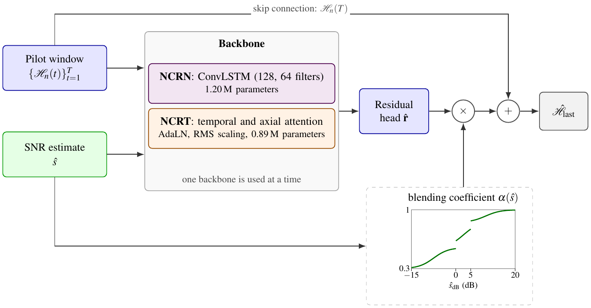
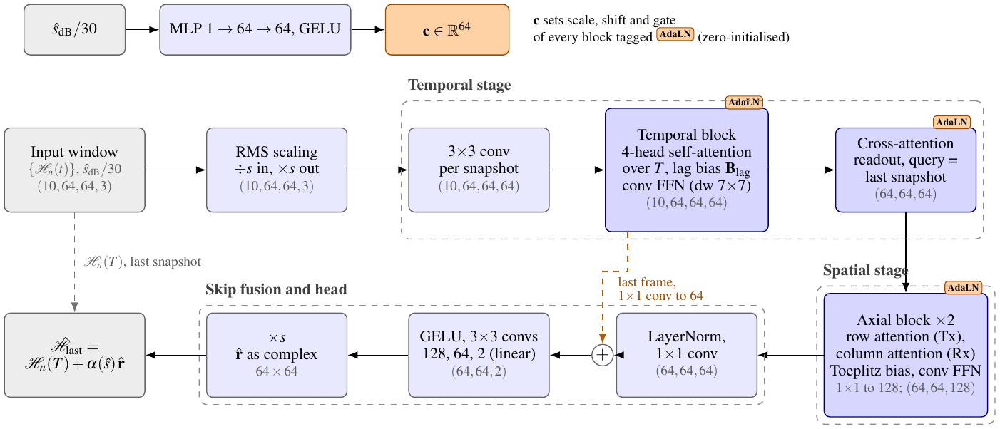

# Attention-Based Residual Learning Channel Estimation for Massive MIMO

Code, pretrained checkpoints and result data for the manuscript **"Attention-Based Residual Learning Channel Estimation for Massive MIMO"** (Apurva Kumar, Vibha Patel, Shweta Kukade), submitted to *Vehicular Communications*.

The repository contains two noise-conditioned residual estimators for a 64×64 massive-MIMO channel, the baselines they are compared with, the channel generators, and the scripts that regenerate every table of the paper.

> **Status:** the manuscript is under review. Table and figure numbers below refer to the submitted version and may change in production; every table is also identified by its LaTeX label (for example `tab_headline`), which will not change.

---

## 1. What this project does

A base station with 64 antennas receives ten pilot symbols from a moving user and must estimate the 64×64 channel at the **last** pilot symbol, without knowing the signal-to-noise ratio (SNR) in advance.

Instead of regressing the whole channel, the networks predict only the **residual** between the true channel and the noisy least-squares (LS) estimate of the last pilot, and receive the SNR as an input:

```text
r = H_last − Hn(T)          (residual the network predicts)
Ĥ = Hn(T) + α · r̂           (final estimate; α = 1 is the raw output)
```

<p align="center">
  
  <br><em>Pipeline shared by NCRN and NCRT. The skip connection carries the noisy LS estimate of the last pilot; the blending coefficient α(ŝ) is optional (α = 1 gives the raw output).</em>
</p>

Two backbones share this pipeline:

| Estimator | Backbone | Parameters |
|:---|:---|---:|
| **NCRN** | ConvLSTM | 1,204,610 |
| **NCRT** (proposed) | Temporal attention + axial attention, RMS scaling, SNR-conditioned layer normalisation (AdaLN), Toeplitz position bias | 888,202 (26.3 % fewer) |

The paper asks whether attention over the pilot window and over the array can replace the recurrent backbone, and where learned estimation stops paying off compared with plain LS.

---

## 2. Key results

NMSE in dB, lower is better. All data are simulated.

| Result | Value | Paper |
|:---|:---|:---|
| Combined TDL test set, 20 dB (500 realisations, one model each): NCRT raw / LS / MMSE / NCRN raw | −29.19 / −27.62 / −27.77 / −24.74 dB | Table 5 |
| Same set, −15 dB: NCRT raw against LS | −6.88 against 7.42 dB (about 14 dB better) | Table 5 |
| Ten TDL scenarios (3–500 km/h): NCRT over NCRN at 20 dB | 2.09–6.13 dB (mean 3.40), **one trained model of each network** | Ten-scenario results |
| Three training seeds of each network, combined test set | NCRT leads by 1.6–4.1 dB from −15 to 15 dB and by 0.92 dB at 20 dB (0.65 dB with a computed blend); standard deviation at 20 dB: NCRN 1.83, NCRT 0.58 dB | Table 8 |
| Raw output against blends (NCRT) | raw output is the right choice up to about 10 dB; a heuristic blend costs up to 12.66 dB; a computed coefficient helps only at high SNR | Raw and blended outputs |
| Pilots 9 µs apart: NCRT over LS at −15 dB | 16.88 dB | Table 15 |
| Order of the earlier pilots permuted or reversed | NCRT changes by at most 0.20 dB, so it acts as a multi-snapshot denoiser, **not a channel tracker** | Table 17 |
| Held-out application links, equal fine-tuning budgets | NCRT ahead of NCRN in 48 of 48 comparisons; both behind LS at 20 dB | Application studies |
| Adapted published estimator (Sa-DLCS, see below) | about 5.4 dB behind NCRT at 20 dB; slightly ahead of NCRT at −15 dB (seed ranges overlap) | Table 10 |

At 20 dB, LS beats the learned estimators on most non-TDL and link-level tests. Learning pays off at low and mid SNR.

---

## 3. Estimators in this repository

| Name | Description | Folder |
|:---|:---|:---|
| LS, Wiener MMSE | Classical references | `shared/baselines.py` |
| CNN-Sparse | Convolutional network with a hard top-k support mask, one snapshot (1,706 parameters) | `stage2_tdl/cnn_sparse/` |
| CNN-LSTM | Two-layer ConvLSTM regressing the channel directly (17,618 parameters) | `stage2_tdl/cnn_lstm/` |
| ConvLSTM-ISTA | The CNN-LSTM network followed by three soft-threshold steps at inference (17,618 parameters). Our own construction, **not** a reproduction of a published method | `stage2_tdl/sa_dlcs/` |
| Sa-DLCS (adapted) | Adaptation of the sparsity-adaptive estimator of Wang *et al.* (IEEE TCCN 2025): DFT, mean-threshold masking and a fully connected network, retrained on our TDL data (982,378 parameters). The original was designed for static indoor channels and a single snapshot, so this is an **adaptation, not a reproduction** | `stage2_tdl/sa_dlcs/` |
| NCRN | ConvLSTM residual network (1,204,610 parameters) | `stage2_tdl/ncrn/` |
| NCRT | Attention residual network (888,202 parameters) | `stage2_tdl/ncrt/` |

### NCRT architecture

<p align="center">
  
  <br><em>NCRT. Temporal self-attention over the ten pilots, a cross-attention readout at the last snapshot, two axial (transmit and receive) attention blocks with a Toeplitz bias, and an SNR-conditioned AdaLN.</em>
</p>

---

## 4. Repository layout

```text
VehCom_Release/
├── stage2_tdl/             # Model architectures and training pipelines
│   ├── ncrt/               # NCRT layers and training implementation
│   ├── ncrn/               # NCRN ConvLSTM training implementation
│   ├── sa_dlcs/            # Sa-DLCS (adapted) and ConvLSTM-ISTA
│   ├── cnn_lstm/           # Two-layer ConvLSTM baseline
│   └── cnn_sparse/         # Spatial CNN with top-k support mask
├── shared/                 # Channel generation and baselines
│   ├── channels.py         # 3GPP TR 38.901 TDL-A to TDL-E generators
│   ├── baselines.py        # LS, Wiener MMSE, ISTA shrinkage, blending
│   ├── matlab_channels.py  # 5G NR and 6G sub-THz channel loaders
│   └── v2x_uav_channels.py # Vehicular and UAV channel loaders
├── models/                 # Pretrained weights (.keras)
│   ├── ncrt_tdl_64.keras   # Base synthetic NCRT model
│   ├── ncrn_tdl_64.keras   # Base synthetic NCRN model
│   ├── ablations/          # Three-seed models (seeds 42, 100, 2024)
│   └── sa_dlcs_wang/       # 12 adapted Sa-DLCS models (arithmetic/harmonic × Wang/curriculum × 3 seeds)
├── scripts/                # Evaluation and reproducibility scripts
├── outputs/
│   ├── csv/                # Numerical CSVs behind the tables
│   └── figures/            # Vector figures (PDF/PNG)
├── plotting/               # Figure plotting scripts
├── docs/images/            # Pipeline and architecture diagrams used in this README
├── data/                   # Channel synthesis utilities and test fixtures
├── requirements.txt
├── Dockerfile              # Multi-arch container build specification
├── docker-compose.yml      # Docker compose configuration with host volume mounts
├── .dockerignore
├── .gitignore
├── train_all.sh            # Master script to train all 5 base estimators
├── eval_all.sh             # Master script to evaluate tables and reproduce figures
└── README.md
```

---

## 5. Installation

### Option A: Local Python Environment
Python 3.10 or newer is recommended.

```bash
git clone <repository-url>
cd VehCom_Release
python -m venv .venv && source .venv/bin/activate   # optional
pip install -r requirements.txt
```

### Option B: Docker Container (Recommended for Reproducibility)
A Dockerfile and `docker-compose.yml` are provided for zero-setup execution without managing local Python dependencies:

```bash
# Build and enter the container interactively:
docker compose run --rm ncrt

# Or run the evaluation pipeline directly (outputs persist to host ./outputs):
docker build -t ncrt-vehcom .
docker run -it --rm -v $(pwd)/outputs:/workspace/outputs ncrt-vehcom bash eval_all.sh
```

Tested package ranges:

| Package | Version |
|:---|:---|
| TensorFlow | ≥ 2.12 and < 2.17 |
| NumPy | ≥ 1.24 |
| SciPy | ≥ 1.10 |
| Matplotlib | ≥ 3.7 |
| Pandas | ≥ 2.0 |

The latency figures in the paper were measured on an Apple M1 at batch sizes 1 and 32. Absolute timings depend on the hardware and the TensorFlow build; the parameter counts and multiply-accumulate counts do not.

---

## 6. Reproducing the tables

Each table is produced by one script, which writes the CSV that the manuscript table is built from. Run the commands from the repository root.

| Paper table | LaTeX label | What it shows | Script | Output CSV |
|:---|:---|:---|:---|:---|
| Table 5 | `tab_headline` | Combined TDL-64 test set, 500 realisations, 95 % intervals | `scripts/rerun_task4_ci95_ratio.py` | `outputs/csv/headline_combined_tdl_64_ci95.csv` |
| Table 6 | `tab_plugin` | Measured plug-in blending coefficient α̂ | `scripts/eval_link_level_raw_and_blended.py` | `outputs/csv/measured_plugin_blend_eval.csv` |
| Table 7 | `tab_ablation` | Protocol-matched baselines and NCRT ablation | `scripts/run_ablation_and_baselines_suite.py` | `outputs/csv/ablation_ladder_combined_tdl_64_spread.csv` |
| Table 8 | `tab_seeds3` | Three-seed NCRT against NCRN | `scripts/train_eval_three_seed_ncrn_ncrt.py` | `outputs/csv/headline_three_seed_ncrn_ncrt_eval.csv` |
| Table 9 | `tab_shrink` | Inference-only ISTA step ablation (μ-only, λ-only) | `scripts/eval_wang_and_mu_lambda_ablations.py` | `outputs/csv/ablation_mu_lambda_checkpoints.csv` |
| Table 10 | `tab_wang` | Sa-DLCS (adapted), three seeds, combined test set | `scripts/eval_wang_and_mu_lambda_ablations.py` | `outputs/csv/sa_dlcs_wang_on_combined_test_tdl_64.csv` |
| Table 11 | `tab_snroffset` | Sensitivity to an error in the SNR input | `scripts/eval_offset_sweep_and_noise_est.py` | `outputs/csv/snr_offset_sweep_combined_tdl_64.csv` |
| Table 12 | `tab_link` | Link-level BER and spectral efficiency (LMMSE receiver) | `scripts/link_level_ber_se.py` | `outputs/csv/link_level_ber_se_comprehensive.csv` |
| Table 13 | `tab_whitectrl` | White-error and de-biasing control for the 20 dB SE gap | `scripts/eval_se_gap_table7_config.py` | `outputs/csv/link_level_se_table7_whitenoise_debiased.csv` |
| Table 14 | `tab_cost` | Complexity and latency | latency script (see `outputs/csv/latency_cost.csv`) | `outputs/csv/latency_cost.csv` |
| Table 15 | `tab_mob9` | Pilot spacing of 9 µs, zero-shot and retrained | `scripts/eval_and_train_9us_mobility.py` | `outputs/csv/mobility_9us_spacing_eval.csv` |
| Table 16 | `tab_paa` | Phase-aligned average control at 9 µs | `scripts/eval_9us_phase_aligned_average.py` | `outputs/csv/mobility_9us_phase_aligned_average.csv` |
| Table 17 | `tab_shuffle` | Frame-order control at 9 µs (permuted and reversed) | `scripts/eval_9us_frame_shuffle_control.py` | `outputs/csv/mobility_9us_frame_shuffle_control.csv` |
| Table 18 | `tab_appseq` | Held-out application links, equal fine-tuning budgets | `scripts/train_eval_heldout_applications_equal_budget.py` | `outputs/csv/application_heldout_equal_budget_eval.csv` |
| Table 19 | `tab_vsls` | Improvement over LS at 20 dB across the ten scenarios | `scripts/eval_ncrt_pooled_tdl_64.py` | `outputs/csv/ncrt_vs_ncrn_full_pilot.csv` |

Example:

```bash
python scripts/rerun_task4_ci95_ratio.py
```

To run all evaluation scripts and regenerate publication figures in one command:

```bash
bash eval_all.sh                 # Full evaluation suite
bash eval_all.sh --figures-only  # Regenerate only paper figures
```

---

## 7. Figures

Figures 1 to 10 of the main paper are vector PDFs in `outputs/figures/`; the per-scenario and application figures are in the supplementary material.

| Figure | Content |
|:---|:---|
| 1 | Structure of the learned estimators |
| 2 | Pipeline shared by NCRN and NCRT, with the blending coefficient α(ŝ) |
| 3 | NCRT architecture |
| 4 | NMSE against SNR on the combined TDL-64 test set |
| 5 | Pooled ten-scenario evaluation, blended and raw outputs |
| 6 | NCRT gain over NCRN against SNR |
| 7 | Per-scenario NMSE at 20 dB and NCRT gain over NCRN |
| 8 | F1 score of active-pair detection per scenario and SNR |
| 9 | Raw and blended NMSE per scenario at −15 dB and +20 dB |
| 10 (a–c) | NMSE against SNR on the MATLAB 5G NR, 6G sub-THz (142 GHz) and combined suites |

Plotting scripts: `plotting/plot_clean_style.py`, `plotting/plot_10_tdl_scenarios.py`, `plotting/generate_clean_journal_figures.py`, `stage2_tdl/ncrt/plot_channel_evolution.py` and `stage2_tdl/ncrt/plot_raw_vs_blended.py`.

---

## 8. Training from scratch

```bash
# Retrain all five models in sequence with master script:
bash train_all.sh                # Full training (~30-45 mins on GPU / Apple Silicon)
bash train_all.sh --quick        # Fast smoke-test (2 epochs/model, ~1-2 mins)
bash train_all.sh --skip-cnn     # Skip CNN baselines

# Or train individually:
# NCRT (30 epochs; batch 2 with gradient accumulation 2, an effective batch of 4 sequences)
python stage2_tdl/ncrt/train_ncrt_tdl.py --epochs 30 --bs 2 --accum 2

# NCRN
python stage2_tdl/ncrn/train_ncrn_tdl.py

# Sa-DLCS (adapted), all variants
python stage2_tdl/sa_dlcs/train_eval_sadlcs_wang_adapted.py
```

Training protocol of NCRN and NCRT (Experimental protocol section of the paper):

- Synthetic 3GPP TDL channels generated online; 30 epochs of 50 updates of 4 sequences (6,000 sequences); Adam with a learning rate of 3×10⁻⁴ and gradient-norm clipping at 1; MSE loss.
- Three-phase SNR curriculum of ten epochs each: [5, 15] dB, then [0, 15] dB, then [−5, 15] dB. **The training SNR never exceeds 15 dB, so results at 20 dB are an extrapolation.**
- The weights are selected with the training loss only, on freshly drawn synthetic batches.
- Three training seeds (42, 100, 2024) are used for the seed and ablation studies.

The small baselines (CNN-Sparse, CNN-LSTM, ConvLSTM-ISTA) were trained with their own simpler recipes at a fixed 10 dB, and the paper also reports them retrained under the NCRN and NCRT protocol (Table 7). Sa-DLCS (adapted) is trained under two protocols: the published settings (200 epochs of 25 minibatches, RMSprop, fixed 10 dB, no SNR input) and the NCRN and NCRT curriculum.

---

## 9. Data and channel sources

| Suite | Source |
|:---|:---|
| TDL-64, ten scenarios (3–500 km/h) | `shared/channels.py`, following 3GPP TR 38.901 TDL profiles with Jakes Doppler, 64×64 uniform linear arrays, ten pilot symbols 1 µs apart |
| MATLAB 5G NR | CDL channels generated with the MATLAB 5G Toolbox; loader in `shared/matlab_channels.py` |
| 6G sub-THz (142 GHz) | Measurement-based channel model at 140 GHz, Zenodo [10.5281/zenodo.7640353](https://doi.org/10.5281/zenodo.7640353); loader in `shared/matlab_channels.py` |
| UAV air-to-ground and V2X / V2V | Application channel models; loaders in `shared/v2x_uav_channels.py` |

Check the licence of each external data source before redistributing any of its files.

---

## 10. Scope and known limitations

These are stated in the paper and repeated here so that the results are read correctly:

- All data are simulated; there is no over-the-air validation.
- The ten-scenario suite and the later experiments use **one trained model of each network**. The three-seed comparison on the combined test set is the more reliable one.
- The main NCRT model is about 2 dB better at 20 dB than the mean of its retrained seeds. The cause has not been isolated.
- NCRT is a **multi-snapshot denoiser**: permuting or reversing the earlier pilots changes it by at most 0.20 dB. It does not follow the motion of the channel.
- The pilot-based SNR estimate still assumes a known channel power.
- The models trained on TDL channels do not transfer to sub-THz and application channels without fine-tuning; the fine-tuned results on the evaluated channels are in-sample, and the held-out tables should be used for generalisation claims.
- In the early 64×64 TDL evaluations (Table 5 and Figure 4) the noise was generated for unit channel power and not scaled to the actual channel power, so the SNR axis there is nominal; the paper accounts for this whenever those results are compared with LS.

---

## 11. Citation

If you use this code, please cite the manuscript. The BibTeX entry will be updated when the article is published.

```bibtex
@unpublished{kumar2026ncrt,
  author = {Kumar, Apurva and Patel, Vibha and Kukade, Shweta},
  title  = {Attention-Based Residual Learning Channel Estimation for Massive {MIMO}},
  note   = {Manuscript submitted to Vehicular Communications},
  year   = {2026}
}
```

Please also cite Wang *et al.* (IEEE Trans. Cogn. Commun. Netw., 2025) if you use the Sa-DLCS (adapted) models.

---

## 12. Licence

Add a `LICENSE` file before publishing (for example MIT or Apache-2.0) and name it here.

---

## 13. Contact

Corresponding author: Vibha Patel, `vibha.patel@mitwpu.edu.in`
Department of Electrical and Electronics Engineering, Dr. Vishwanath Karad MIT World Peace University, Pune, India.
